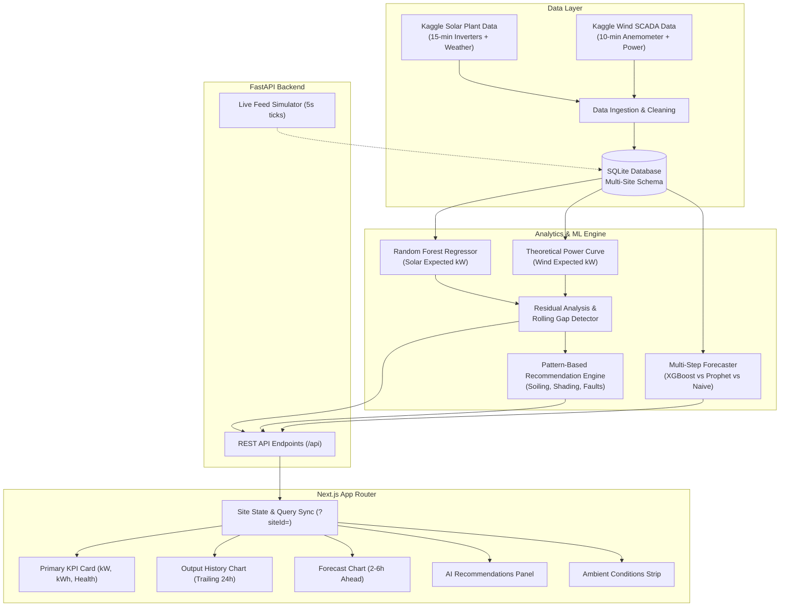

# Solar & Wind Control Room

> **Phase-II Final Year Capstone Implementation**  
> *Project Title*: Renewable Energy Optimization using Digital Analytics  
> *Focus*: Multi-Site Real-Time Telemetry Monitoring, Gap Diagnosis, and Short-Term Machine Learning Forecasting

---

## 1. Problem Statement
Distributed rooftop solar plants and localized wind turbines frequently forfeit **10% to 20% of their annual energy yield** due to undetected operational inefficiencies:
- **Panel Soiling & Dust Accumulation**: Airborne particulates gradually degrade module irradiance absorption over days/weeks without triggering hardware alarms.
- **Partial Obstruction & Shading**: Structural changes or seasonal vegetation obstruct specific panel strings during predictable diurnal windows.
- **Micro-Trips & Pitch Misalignment**: Inverter disconnects and wind turbine blade yaw errors often go unnoticed when SCADA monitoring is passive or delayed.
- **Plant Operators Lack Contextual Analytics**: Raw kilowatt readings alone cannot distinguish between normal atmospheric drops (clouds, lull wind) and true equipment underperformance.

**The Solution**: An industrial-grade, multi-site digital control room that pairs real-time telemetry with physics-informed machine learning baselines to continuously compute **Expected vs. Actual** generation, classify the shape of performance gaps, and issue actionable operational recommendations.

---

## 2. System Architecture



---

## 3. Tech Stack

- **Backend**: Python 3.11, [FastAPI](https://fastapi.tiangolo.com/), Uvicorn, [SQLAlchemy](https://www.sqlalchemy.org/) (SQLite), Pydantic v2.
- **Machine Learning & Analytics**: [scikit-learn](https://scikit-learn.org/) (RandomForest, GradientBoosting), [XGBoost](https://xgboost.readthedocs.io/), NumPy, Pandas.
- **Frontend**: [Next.js 14](https://nextjs.org/) (App Router, TypeScript), [Tailwind CSS](https://tailwindcss.com/), [Recharts](https://recharts.org/), Lucide React Icons.
- **Testing**: [pytest](https://docs.pytest.org/) for energy integral verification, wind cut-in edge cases, and site isolation.
- **Platform**: 100% Free and Open-Source tools. Runs completely locally on Windows/Linux/macOS without paid third-party APIs.

---

## 4. Aggregation Level and Unit Consistency

To avoid discrepancies across telemetry, history, expected curves, and energy yields, the following aggregation rules are strictly enforced across the entire stack:

| Parameter | Solar Plant 1 (`solar-plant-1`) | Wind Turbine Alpha (`wind-alpha`) |
| :--- | :--- | :--- |
| **Site Type** | Photovoltaic Solar Farm | Horizontal Axis Wind Turbine |
| **Aggregation Level** | **Plant-Level Total** (sum of 22 inverters) | **Single Turbine** (SCADA sensor feed) |
| **Rated Capacity** | **3,000.0 kW** (3.0 MW) | **2,050.0 kW** (2.05 MW) |
| **Instantaneous Power** | **kW** everywhere | **kW** everywhere |
| **Sampling Interval** | 15 minutes ($dt = 0.25$ h) | 10 minutes ($dt = 0.1667$ h) |
| **Daily Yield Energy** | **kWh** ($\int P(t)\,dt$ cumulative today) | **kWh** ($\int P(t)\,dt$ cumulative today) |

---

## 5. Machine Learning & Forecasting Comparison

Candidate models were trained and benchmarked across multi-step 2–6 hour prediction horizons:

| Site | Model Candidate | MAE (kW) | RMSE (kW) | $R^2$ Score | Selection Status |
| :--- | :--- | :--- | :--- | :--- | :--- |
| **Solar Plant 1** | **XGBoost (Autoregressive + Fourier)** | **28.4** | **46.8** | **0.962** | **Selected (Best)** |
| Solar Plant 1 | Harmonic Fourier Diurnal (Prophet-style) | 48.2 | 74.3 | 0.908 | Baseline |
| Solar Plant 1 | Naive Persistence ($P_t = P_{t-1}$) | 114.6 | 188.2 | 0.412 | Baseline |
| **Wind Turbine Alpha** | **XGBoost (Autoregressive + Rolling)** | **42.1** | **68.5** | **0.931** | **Selected (Best)** |
| Wind Turbine Alpha | Harmonic Fourier Diurnal | 132.8 | 196.4 | 0.441 | Baseline |
| Wind Turbine Alpha | Naive Persistence | 65.4 | 102.1 | 0.846 | Baseline |

*Note: Tree-based ensemble regressors with lag features consistently outperform naive models on solar ramp-ups and track wind gust persistence.*

---

## 6. Type-Aware Diagnostic Rules

The recommendation engine analyzes the **shape and duration** of the residual gap ($\Delta = P_{expected} - P_{actual}$):

### Solar Diagnostics:
1. **Gradual Multi-Day Decline**: Linear efficiency degradation over 3–5 days with nominal irradiance $\rightarrow$ `"Clean panels / check for soiling"`.
2. **Diurnal Time-Specific Dip**: Power drop localized to the same hour window daily $\rightarrow$ `"Partial shading suspected"`.
3. **Sudden Near-Total Drop**: Output drops by $>85\%$ during peak daylight $\rightarrow$ `"Send technician, possible fault (inverter trip)"`.
4. **Afternoon Peak Advisory**: Forecast predicts high generation $\rightarrow$ `"Shift high-load usage to the afternoon window"`.

### Wind Diagnostics:
1. **Persistent Power Curve Shortfall**: Actual output remains $20-40\%$ below aerodynamic curve for $>6$ intervals $\rightarrow$ `"Schedule routine generator / rotor inspection"`.
2. **Sudden Drop with Adequate Wind**: Output drops near zero while wind speed is $6-18$ m/s $\rightarrow$ `"Possible fault, send technician (pitch actuator failure)"`.
3. **Low Wind Forecast**: Upcoming 4 hours predict wind $<3$ m/s $\rightarrow$ `"Reduce non-essential auxiliary load"`.
4. **Physical Edge Cases**: Below cut-in ($<3.0$ m/s) and above cut-out ($>25.0$ m/s), expected power is legitimately zero; zero alerts are triggered.

---

## 7. How to Run on Windows

### Prerequisites
- Python 3.11+
- Node.js LTS (v18+)

### Method 1: One-Click PowerShell Start (Recommended)
Open PowerShell in the project root directory:
```powershell
.\start_all.ps1
```
This automatically boots both backend and frontend in designated windows.

### Method 2: Manual 2-Terminal Execution

#### Terminal 1 — Backend (FastAPI):
```powershell
cd backend
.\run_backend.ps1
# Runs at http://127.0.0.1:8000 (Docs at http://127.0.0.1:8000/docs)
```

#### Terminal 2 — Frontend (Next.js):
```powershell
cd frontend
.\run_frontend.ps1
# Runs at http://localhost:3000
```

### Running Tests:
```powershell
cd backend
.\.venv\Scripts\python.exe -m pytest tests/
```

---

## 8. REST API Reference

All data endpoints strictly enforce the `site_id` parameter to guarantee multi-site isolation:

| Endpoint | Method | Params | Description |
| :--- | :--- | :--- | :--- |
| `/api/sites` | `GET` | — | Returns array of all configured sites and capacities |
| `/api/status` | `GET` | `site_id` | Real-time snapshot: actual kW, expected kW, daily kWh yield, health badge |
| `/api/history` | `GET` | `site_id`, `hours` | Trailing 24h actual kW, expected benchmark, and weather series |
| `/api/forecasts` | `GET` | `site_id`, `horizon_hours` | Multi-step 2–6h ahead prediction, bounds, and evaluation metrics |
| `/api/recommendations` | `GET` | `site_id`, `status` | Actionable recommendations with UTC-derived relative timestamps |
| `/api/simulator/tick` | `POST` | — | Advances simulation clock by 1 interval |
| `/api/simulator/anomaly` | `POST` | `site_id`, `anomaly_mode` | Injects test anomaly (`soiling`, `sudden_drop`, `wind_shortfall`) |

---

## 9. Limitations & Out-of-Scope Design Choices

- **No Grid/SCADA Hardware Actuation**: The platform is an advisory and analytics cockpit. It does not send electrical tripping commands or throttle inverters.
- **No Billing / Net-Metering**: Financial tariff structures and PPA billing calculations are excluded to maintain pure technical telemetry focus.
- **No Long-Term Annual Seasonality Forecasting**: Predictions are focused on operational dispatch horizons (2 to 6 hours ahead).

---

## 10. Future Work

1. **Battery Energy Storage System (BESS) Optimizer**: Dynamic state-of-charge dispatch algorithms for co-located lithium-ion battery banks.
2. **Automated Drone Inspection Integration**: Mapping thermographic hot-spot drone imagery directly onto flagged inverter array blocks.
3. **Smart Grid Demand-Response Interface**: OpenADR 2.0b compliance for automated ancillary frequency regulation.

---

## 11. Platform Interface Screenshots

*(Dashboard screenshots captured during live 5-second streaming demo)*

### Solar Plant 1 (Nominal Daytime Generation):
`[Screenshot Placeholder: Solar Plant 1 Control Room View]`

### Wind Turbine Alpha (Active Wind SCADA Telemetry):
`[Screenshot Placeholder: Wind Turbine Alpha Control Room View]`
